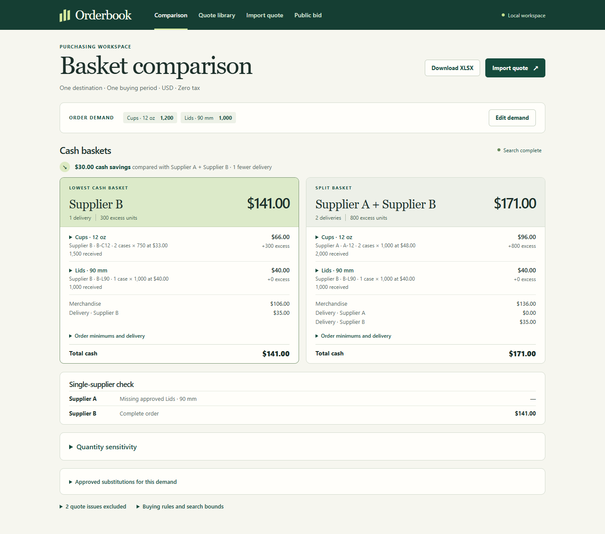

# Buyer milestone · 26 November 2026

Microsoft Edge 158.0.4370.33 on Windows imported both sample files through the file inputs, sheet and column selectors, line decisions and terms confirmation. The comparison below was also reopened in a headed Edge process using the saved buyer profile.

| Demand | Lowest cash | Alternative | Observed difference |
|---|---|---|---|
| 1,200 cups | A $96, two cases | B $101, two cases plus freight | A saves $5 |
| 2,100 cups | B $134, three cases plus freight | A $144, three cases | B saves $10 |
| 1,200 cups + 1,000 compatible lids | B $141, one delivery | A cups + B lids $171, two deliveries | B saves $30 and one delivery |

The $141 receipt covers 1,500 cups and 1,000 lids for $106 merchandise plus $35 delivery. The split covers 2,000 cups and 1,000 lids for $136 merchandise plus $35 delivery. A alone lacked approved lids and received no rank.

**Checks run.** Node v24.19.0 ran `npm test` with 13 passing tests. The pricing expectations and exhaustive receipt oracle were specified before implementation. Their initial run failed on the absent optimizer module. The finished optimizer agreed per supplier set in all 80 deterministic small markets. Named cases cover missing pack, incompatible lids, inclusive minimum, legal top-up, freight waiver, ties, a winning split, unfillable demand and interrupted search.

**Browser checks.** `npm run test:edge` passed in installed Edge using Playwright Core 1.62.1. It checked all three demand totals, source row and case price, reload persistence, exact approval reuse, a changed price requiring review, unresolved terms excluding a supplier, demand CSV loading, and an unfillable item yielding zero ranked baskets. No browser page errors were observed. A separate normal-UI run with `node tests/edge.mjs --keep-workspace` created the buyer profile at `.work/buyer-edge` for port 4173. Closing and reopening that profile preserved $141 and $171.

## Final app verification

The production build passed 18 Node tests and three Edge browser suites. An independent ledger checked every cup quantity from 1 through 5,000 with and without fixed lid demand. Edge exercised the 1,501–2,000 cup split-order interval, large-range paging, arbitrary quantities and explicit application to demand.

- **Original basket.** The browser downloaded the [comparison workbook](Orderbook-comparison.xlsx) for 1,200 cups and 1,000 lids. It records all B at $141 and the split at $171. The [screenshot](edge-comparison.png) shows both orders with SKU, cases, quantities, excess and delivery.
- **Revised quote.** Revising A-12 from $48 to $30 per 1,000-cup case changed the split to $135. All B stayed at $141. Browser reload and a separate changed-file reimport reproduced both totals. The revised download retained the source price, current price and buyer citation.
- **Historical decision.** In the separate 140-serving illustration, accepting Conagra’s 72-pack at the manufacturer-supplied rate yielded 144 servings for $76.48. Accepting Nardone at the manufacturer rate yielded 140 for $92. Confirming Nardone’s donated-mozzarella basis changed its order to $32.32. Freight was zero by illustration assumption.
- **Workbook check.** Edge tests reconciled each plan’s line extensions and per-supplier fees from the downloaded XLSX. An independent openpyxl read checked cached amounts, the delivered-order formula, the freight source row, interval coverage and wrapped cells.
- **Demand intake.** A multi-sheet XLSX with demand on physical rows 3 and 5 produced the same $141 and $171 baskets. Its saved demand exported with the original source values and locations.
- **Desktop Excel.** Excel 16.0, build 20326, reopened the nine-sheet browser download read-only, recalculated it, and reproduced $141 and $171 by extending the case quantities and charging each used supplier once. All saved row heights met Excel AutoFit in this fixture. Excel's print rendering also showed the wrapped quantity-switch explanations and their file, sheet and row references. [Excel verification](excel-validation.json)
- **Clean checkout.** Reproduce on this PC with `npm.cmd ci --offline`, `npm.cmd test`, `npm.cmd run build`, `npm.cmd run test:edge` and `.\tests\verify-excel.ps1 -Workbook .work\edge-run\Orderbook-comparison.xlsx`. The Edge suite writes its newly downloaded workbook under the ignored `.work/edge-run/` directory.
